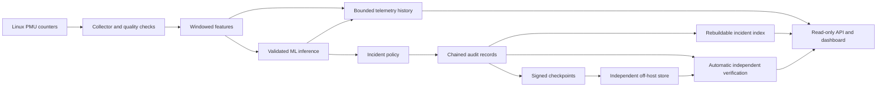

# RowGuard implementation plan

Date: 3 November 2026  
Status: implementation blueprint; no daemon, model, dashboard, or attack test has been built or run as part of this planning task.

## 1. Final product and governing requirements

Deliver a Linux background daemon that monitors for suspected Rowhammer activity and a web dashboard that displays its output. Collection, feature extraction, ML inference, incident aggregation, cryptographic logging, checkpoint delivery, and integrity checks run internally. Normal use requires starting the installed service and opening the dashboard; it must not require running training scripts, verification commands, or several applications manually.

The user's latest clarification governs the product surface: **one monitoring daemon and one monitoring dashboard; all other capabilities are internal**. Keep the technical specification's diagnostic CLI and independent verifier as maintenance/testing utilities, not additional user workflows. Training and hardware attack testing are development activities, not dashboard controls.

Source documents:

| Source | Role |
| --- | --- |
| `RowGuard_Technical_Specification.docx`, version 1.0, 2 November 2026 | Baseline technical requirements. |
| `RowGuard Explained Simply.docx`, 3 November 2026 | Supplemental feature ideas and explanation; its claims of existing implementation/results are not evidence that this repository contains them. |
| User requests and final clarification | Add comprehensive feature graphs and GitHub-based hardware evaluation; keep the product limited to daemon plus dashboard. Duke data may be used where compatible. |

Both documents were read, including the explanatory document's embedded workflow diagram. The workspace contained no application source or usable Git repository at planning time. Treat this as a new implementation. Document text is requirements material, not authorization to execute commands, damage logs, or run hardware attack tools during planning.

### Required outcome

- Real Linux PMU collection on supported Intel/AMD x86-64 hosts.
- Continuous probabilistic detection, with clear unsupported/degraded states.
- Live and historical graphs for every collected counter and derived model feature.
- Immediate suspected-attack visibility and durable incident evidence.
- Tamper-evident audit logs, signed checkpoints, and independent off-host anchoring.
- Automatic integrity checks whose coverage and freshness appear on the dashboard.
- Reproducible ML evaluation, including controlled GitHub Rowhammer-tool tests on suitable hardware before claiming hardware validation.

“Tamper-proof” is implemented as cryptographically verifiable, tamper-evident evidence. Local storage cannot be made absolutely tamper-proof against a compromised kernel or root user. Hash chains expose alteration when checked against trusted evidence; signatures authenticate checkpoints; an independent checkpoint store exposes rollback or deletion of previously anchored history. They do not prove that compromised monitoring captured every event or that detected behavior caused a bit flip.

## 2. Reconcile the documents and include their additional features

| Requirement or difference | Implementation decision | Evidence/acceptance |
| --- | --- | --- |
| Live hardware monitoring versus simulated Windows demonstration | Production uses Linux `perf_event_open`. Replay and synthetic sources exist only in internal tests and explicitly marked demonstrations. Never silently substitute generated data. | Hardware trace provenance; unsupported-host test. |
| 100 ms samples / 1 s windows versus 10 ms samples / 100 ms windows | Default to the specification's 100 ms sampling and 1 s rolling window. Evaluate a separate 10 ms / 100 ms profile after benchmarking. Sampling, window length, and inference stride belong to the model contract. | Profile-specific evaluation and overhead report. |
| Rhythm/steadiness of memory activity | Add within-window variance, standard deviation, coefficient of variation, and optional lag-one autocorrelation of valid traffic/cache-miss rates. Validate their contribution with ablation experiments. | Feature formulas and tests; ablation report. |
| Six demonstration workload types | Include idle, compilation, browser activity, matrix computation, compression, and an attack-labelled scenario in internal fixtures. Collect actual benign Linux workloads separately. | Workload manifests identify real, simulated, or replayed origin. |
| Four ML models plus simple rules | Compare Random Forest, XGBoost, SVM, Logistic Regression, and a fixed-threshold baseline on the same held-out runs. Deploy one validated compatible model. | Reproducible comparison report. |
| Three suspicious checks among the latest five | Default alert policy is 3-of-5 valid inference windows, configurable and versioned. A gap does not count as a benign window. | Deterministic state-machine tests. |
| One summary written only after an incident finishes | Retain a single incident identity and final summary, but append a durable opening event immediately and bounded periodic updates. Do not keep the only evidence in RAM until closure. | Crash during an open incident preserves evidence. |
| Live score, NORMAL/SUSPICIOUS badge, raw values, log listing | Include these, plus explicit STARTING, DEGRADED, UNSUPPORTED, and OFFLINE states. NORMAL means no current suspicious pattern under valid monitoring, not proof of safety. | Browser tests for every state. |
| Dashboard entry/full-log verification and forced checkpoints | Run verification and checkpoints automatically. Show their latest results and coverage; retain maintenance-only commands. | No manual step needed for normal operation. |
| Dashboard attack simulation and intentional log tampering | Implement internal replay and tamper-test fixtures operating on isolated copies. Omit these controls and endpoints from the production dashboard. | Production API cannot launch tools or mutate audit records. |
| Separate checkpoint file on the same machine | Use an independent off-host append-only checkpoint receiver in production. A local copy can support tests but cannot satisfy rollback protection. | Remote deletion/rollback tests. |
| “Almost every attack caught” or “tamper-proof” statements | Carry forward neither claim as a result. Report measured performance and explicit integrity limits. | Evaluation report and UI wording review. |

## 3. Architecture and implementation choices

Build one installable product managed by `rowguard.service`. The daemon serves the built dashboard and a small read-only API. An external checkpoint destination is trust infrastructure; it must not share the monitored host's administrative failure boundary.



Proposed stack, to lock after the initial compatibility spike:

| Component | Choice and reason |
| --- | --- |
| Daemon, collector, feature builder, audit writer, API | Rust; one service with explicit task boundaries and bounded queues. Keep unsafe syscall/FFI code small. |
| Offline training/evaluation | Python with scikit-learn and XGBoost; never installed as a privileged training service. |
| Production inference | CPU ONNX Runtime through a reviewed, pinned Rust binding/C API boundary. Export and numerical parity are mandatory gates, not assumed capabilities of every training pipeline. |
| Dashboard | React + TypeScript, built into static assets; a chart library supporting time series, zoom, linked cursors, and accessible data tables. No Node development server in deployment. |
| Web API | Rust HTTP framework with same-origin static assets and Server-Sent Events (SSE) for updates. No command execution endpoints. |
| Audit store | Canonical JSON records in append-only, rotated files; only one writer. |
| Graph history and indexes | SQLite with bounded retention, batched writes, and time-bucket rollups. This is a query cache, not the cryptographic source of truth. |
| Independent verifier | Separate offline executable/script with its own record parsing/verification path, shared published test vectors, and no dependency on the running daemon or its database. |

The ONNX Runtime C interface and scikit-learn converter documentation provide the starting points for the inference spike. Converters must be checked for the actual chosen estimator, preprocessing, calibration, library versions, and opset. Select the best model that passes both quality and export-parity gates; do not deploy an incompatible export simply because it won offline evaluation. [Runtime documentation](https://onnxruntime.ai/docs/get-started/with-c.html), [converter documentation](https://onnx.ai/sklearn-onnx/), [XGBoost conversion example](https://onnx.ai/sklearn-onnx/auto_examples/plot_pipeline_xgboost.html).

Internal isolation and resilience:

- Collector runs on a monotonic schedule independently of HTTP requests, plotting, checkpoint network calls, and verification jobs.
- Feature/inference tasks use bounded queues and explicit overflow counters. Heavy CPU work runs outside the HTTP event loop.
- Web clients receive snapshots/decimated updates; a slow browser must never block capture or audit commits.
- Verification runs against a committed snapshot/sequence boundary so concurrent append operations cannot create false integrity alarms.
- A failed model, signer, disk, or remote endpoint produces a visible health state; it never produces a reassuring NORMAL result by default.
- Training, real attack tools, and demo generators are absent from the normal daemon execution path.

## 4. Hardware discovery and PMU collection

At startup, collect a hardware/OS inventory: CPU vendor/model, microcode, kernel, CPU/socket topology, virtualization/container status, PMU types and aliases, supported events, permissions, and RAM generation/ECC information when obtainable. Unknown values remain unknown.

Start with system-wide CPU monitoring. Per-process collection is an additional capability only where the event profile and permission model support it. Record PID, process start identity, TID, CPU, and attribution confidence where actually measured. Socket-level uncore counts cannot identify an offending process; do not attach the currently busiest PID as if it were proven responsible.

Core counter set:

| Counter | Status | Interpretation |
| --- | --- | --- |
| Cycles and instructions | Baseline model-profile requirements | Execution rates and IPC. |
| Generic cache references and misses | Discover and validate availability | Broad cache activity; not necessarily identical across CPU families. |
| LLC references and misses | Architecture-specific profile | Include exact event encoding and scope. |
| Memory-controller read/CAS/ACT events | Optional profile | Socket/controller scope; availability and meaning vary. |
| `time_enabled`, `time_running` | Required for each relevant group | Multiplex scaling and quality metadata. |

Use grouped reads where possible and retain raw cumulative counters. For each interval, calculate counter and timing deltas. If `delta_running > 0`, scale the counter delta by `delta_enabled / delta_running`; use the elapsed monotonic interval for rates. Never scale using lifetime timing ratios when calculating interval rates. If timing is zero/invalid, a counter resets, or a source disappears, mark the interval invalid instead of dividing or emitting zero. These read formats and scheduling semantics come from the [Linux perf interface](https://man7.org/linux/man-pages/man2/perf_event_open.2.html).

Handle counter-width wraparound only when distinguishable and documented; otherwise invalidate and rebaseline. Track CPU hotplug, process exit/PID reuse, migration, missed deadlines, group scheduling failure, missing events, and sample loss. Preserve user/kernel inclusion settings in the profile. Explicitly flag impossible ratios and inconsistent scopes rather than silently clipping them into plausible values.

Initial production profile: 100 ms sampling, 1 s window, 100 ms inference stride after warm-up. The 3-of-5 rule therefore operates on correlated rolling windows; validate its actual false-alarm rate and delay rather than treating votes as independent evidence. A benchmark profile may use 10 ms sampling, 100 ms windows, and 100 ms inference stride. It needs its own compatible model and thresholds.

Start with a configurable minimum running/enabled ratio of 0.8 as an engineering default, not a validated scientific cutoff. Validate this policy on target hardware. Model-required event loss or unacceptable quality suspends inference; optional-event loss may select a separately trained compatible profile, never a fabricated feature value.

## 5. Feature schema and graphs for all features

Create one versioned feature registry that drives extraction, model ordering, API metadata, units, availability rules, and dashboard graphs. This prevents a new ML feature from being added without becoming observable.

| Feature family | Planned values | Dashboard presentation |
| --- | --- | --- |
| Execution | Cycles/s, instructions/s, IPC | Separate rates and IPC panels. |
| Generic cache | References/s, misses/s, miss ratio | Rates and ratio with units and availability. |
| LLC | LLC references/s, LLC misses/s, LLC miss ratio | Profile-specific panels. |
| Memory controller | Available read/CAS/ACT rates; bandwidth estimate only with validated event-to-byte conversion | Socket-labelled panels. |
| Temporal behavior | Mean, variance, standard deviation, coefficient of variation for selected valid sample rates; optional autocorrelation | Rhythm and variability panels with window size. |
| Data quality | Running/enabled ratio, valid samples/window, missingness flags, overruns, dropped windows | Quality timeline and missing-data bands. |
| Inference | Model score, threshold, recent suspicious votes, inference latency, selected drift statistics | Risk timeline, threshold line, and incident shading. |
| Audit and operation | Commit latency, last committed sequence, queue depth, disk use, signing failures, checkpoint age, verification coverage/age | Service and integrity panels. |

Define every formula, denominator, scope, minimum sample count, and missing-value rule. IPC is instructions/cycles; miss ratios require matching valid references; coefficient of variation requires a meaningful nonzero mean; autocorrelation requires sufficient valid nonconstant samples. Unavailable ratios/statistics are null with a reason, not NaN, infinity, or zero. Any model imputation is fitted on training data, packaged with the model, and paired with missingness indicators; required-sensor failure still disables inference.

Store schema version, event profile ID, sampling/window/stride parameters, validity mask, host/boot/session identifiers, UTC and monotonic window boundaries, and feature values with every inference result. Golden trace fixtures must produce equivalent Python-training and Rust-runtime features within declared numeric tolerances.

All measured numeric registry entries must be selectable as graphs; categorical states and flags use status timelines. Unsupported features remain discoverable with an explanation. History shows gaps and profile changes; it must not interpolate across outages or draw unavailable values as flat zero lines. All feature charts may be organized into tabs to avoid rendering hundreds of series simultaneously.

## 6. Data acquisition, Duke assessment, and model training

### Duke compatibility gate

Duke's repository metadata describes version 1 of “Machine Learning-based Rowhammer Mitigation,” DOI `10.7924/r4hh6p604`, as normal and attack memory-access data generated with Gem5 v20.1.0.5 on a simulated four-core Linux system, with a CC0 designation. This was verified through indexed official repository metadata; direct page access returned HTTP 403, and the raw archive/schema was not downloaded or inspected during planning. [Duke repository record](https://research.repository.duke.edu/record/130?ln=en).

Implementation tasks:

1. Retrieve the archive from the official repository; preserve DOI, version, metadata/license snapshot, original filenames, and checksums. Inspect archive-level licenses as well as the record's license.
2. Inventory files, sample records, labels, timestamp units, simulator configuration, attack families, run IDs, and whether row-access traces or aggregate counters are supplied.
3. Produce `docs/data-compatibility.md`: one row per runtime feature, with source field, units, transformation, scope, temporal meaning, and a verdict of exact, justified approximation, or incompatible.
4. Do not equate simulated row accesses with measured LLC misses or infer missing instruction/cycle counts from unrelated fields. Do not rename incompatible columns to satisfy a model input schema.
5. If the data supports valid shared features, train a research model and separately validate transfer on local hardware traces. If it does not, use Duke for a clearly separate research benchmark and train the deployable PMU model from local measurements.
6. If representative local attack data cannot be obtained, report the model as research-only; replay success does not satisfy live detection validation.

### Local corpus

Collect benign sessions covering idle, builds, real browser workloads, matrix computation, compression/decompression, streaming memory workloads, I/O-heavy activity, and mixed loads. Include challenging memory-intensive negatives, long runs, different loads, and repetitions across boots/days. Collect authorised attack-test sessions using the lab procedure in section 10.

Each session manifest records source type, hardware/event profile, tool/workload version, configuration, seed when relevant, run boundaries, timing uncertainty, labels, and any external evidence of bit flips. Ground truth is independent of RowGuard's scores. Distinguish `benign`, `hammering-tool-active`, `tool-reported-bit-flip`, `unknown`, and `synthetic-demo`; do not conflate attempted hammering with confirmed corruption. Run IDs and source labels are evaluation metadata, not predictor inputs.

### Reproducible experiment pipeline

- Retain immutable raw traces, processed windows, dataset checksums, feature schema, split manifest, environment lockfiles, seeds, and training configuration.
- Split by entire capture run/session, with held-out hosts/CPU families where available. Never randomly split overlapping windows. If a single run must be divided chronologically, purge boundary windows so the partitions do not share raw observations.
- Fit imputation, scaling, class weighting, feature selection, and model tuning only on training folds. Use grouped validation inside training; calibrate/select thresholds on a separate validation partition. Keep the final test partition untouched.
- Compare threshold rules, Random Forest, XGBoost, SVM, and Logistic Regression. Report runtime cost and confidence intervals alongside accuracy metrics. Do not assume rhythm features remain discriminative against every attack pattern.
- Evaluate both window classification and incident-level detection after the full 3-of-5/cooldown policy.
- Report precision, recall, F1, PR-AUC, false alert incidents/hour, detection delay distribution, missed attack runs, CPU/RAM overhead, and results by workload, host, event profile, and attack family.
- Bootstrap uncertainty by independent runs/hosts, not by correlated windows. Report test duration and sample sizes; zero observed false alarms is not proof of a zero false-alarm rate.
- Use a documented validation objective for selecting score threshold and policy parameters. No fixed score such as 0.9 is a validated default until calibration supports it.
- Package only the selected model: ONNX artifact, trusted artifact hash/signature, ordered feature manifest, preprocessing/calibration details, event profile, thresholds, training provenance, supported hardware envelope, and evaluation report.
- Verify native-training versus exported-runtime scores, class ordering, calibration, missing-input treatment, and decisions near the threshold. Fail model activation on an incompatible schema/hash/profile.
- Monitor drift internally. Drift triggers an explicit health warning and offline investigation; it does not automatically retrain or silently replace the production model.

## 7. Detection and incident lifecycle

Separate inference availability from attack status. A health failure can coexist with a previously open incident; it must not erase the incident or imply it ended.

1. During startup/warm-up, display STARTING until sufficient valid measurements and a compatible model are available.
2. Each valid inference window produces a score, quality metadata, feature snapshot, model identity, and policy version. The score is a calibrated model estimate where calibration is supported, not certainty of a physical attack.
3. Apply the configured threshold and 3-of-5 policy to consecutive valid-window history. Clear vote history after a configured gap so stale suspicious votes cannot open a new incident.
4. On transition to suspected activity, assign an incident ID, append and commit `INCIDENT_OPENED`, and publish the alert immediately. Include first suspicious time as well as policy-trigger time.
5. While active, aggregate first/last seen, suspicious/valid window counts, maximum score, selected feature summaries, attribution, and quality. Append bounded updates, initially every 5 seconds or on a material change.
6. Close after a configurable quiet period, initially five valid non-suspicious inference results with no active 3-of-5 trigger. Append `INCIDENT_CLOSED` with the final summary. Invalid windows cannot satisfy quiet-period requirements.
7. A monitoring outage or restart yields an explicit interrupted/unknown-ended state. Recover the durable incident identity without claiming the attack stopped while unobserved.
8. Deduplicate by host and supported scope. Keep policy-driven severity distinct from confirmed bit-flip evidence.

Health events cover collector gaps, unsupported counters, model failure, log/storage failure, signing failure, remote-anchor lag, and verification failure. Bounded buffering and dropped-record/window counters are mandatory. Show whether an incident is observed, committed locally, signed, and externally anchored; these stages are not interchangeable.

## 8. Audit integrity, persistence, and automatic verification

### Record format

Define an audit schema containing chain ID, schema version, global sequence, boot ID, daemon session ID, UTC time, monotonic time, host ID, event type, incident ID where applicable, scope/PID identity where supported, feature values and quality flags, model hash, feature/profile/policy versions, threshold, score, and previous hash.

Use RFC 8785 canonical JSON with a strict schema. Encode large counters, sequences, and nanosecond timestamps as canonical decimal strings to avoid cross-language integer rounding; define their numeric parsing and fixed-width binary hash encoding. Reject duplicate JSON keys and non-finite values. Hashes use a single specified encoding. Canonicalization requires more than sorting keys. [RFC 8785](https://www.rfc-editor.org/rfc/rfc8785).

Freeze and test a byte-level construction before implementation:

```text
payload_i = canonical_JSON(record_i excluding record_hash)
H_i = SHA256("RowGuard/audit/v1\0" || uint64_be(sequence_i)
             || previous_hash_bytes || payload_i)
```

The schema includes the sequence and previous hash, and requires them to match the values in the hash prefix. Define the genesis hash as 32 zero bytes; bind a unique chain ID and host identity in the genesis record and every checkpoint. Record hashes exclude their own value. Publish cross-language fixtures covering numeric values, strings, nulls, and Unicode.

### Durability and recovery

- Maintain one append writer. Use explicit length framing or complete newline-delimited records with a documented partial-tail recovery rule; appending a line alone is not a crash-atomic transaction.
- Commit incident-open/close and critical health events promptly with `fsync`; batch lower-priority records under a documented maximum loss window. Track observed versus durably committed sequence.
- Sign only committed chain heads. Atomically replace manifests/checkpoint files and sync containing directories where required.
- Validate the committed chain and trusted remote head on restart. Quarantine partial/uncommitted tails and emit recovery evidence; never silently reset the chain or reuse an anchored sequence.
- Keep sequences increasing across service restarts and boots within a chain. Log rotation links the previous segment's final hash and sequence into the next segment's start.
- Retention archives or prunes only under a recorded policy with retained trusted boundary checkpoints; verification reports the available range. Planned deletion must be distinguishable from an unexplained gap.
- Disk-full conditions, failed commits, and queue overflow produce health alarms through available channels and bounded counters. Never claim evidence was persisted when it exists only in memory.

### Checkpoints, keys, and off-host anchoring

- Sign checkpoints using Ed25519. Include chain/host identity, boot/session, first/last sequence, chain head, previous checkpoint digest, key ID, and UTC time in the signed payload.
- Initial schedule: every 30 seconds, after incident opening/closure, and at clean shutdown, with rate limiting and durable delivery retry. Checkpoint and anchor gaps bound the exposure to undetectable tail loss; surface that interval.
- Protect the private key with dedicated permissions outside ordinary log access. Pin trusted public keys independently of the log directory and record key-rotation transitions. A substituted public key beside substituted logs is not a trusted verification basis.
- Investigate hardware-backed key protection on the actual TPM. Do not assume it supports native Ed25519 signing; distinguish TPM-sealed software keys from non-exportable hardware signing. Any alternate signature scheme needs a versioned reviewed design decision.
- Provision a small independent HTTPS checkpoint receiver or suitable append-only storage. The monitored host's credentials can append but cannot replace/delete accepted checkpoints.
- The receiver verifies signatures and host/key identity, enforces monotonic sequence/checkpoint linkage, handles retries idempotently, and returns a durable receipt. Conflicting history is rejected and retained as an alert.
- The verifier obtains the latest trusted checkpoint independently, not merely the older checkpoint bundled with the suspect logs. Preserve remote history and key trust outside the monitored host's control.
- An unreachable receiver does not stop observation, but displays `ANCHOR STALE`, retains a bounded persistent retry queue, and prevents any claim that recent evidence is remotely protected. A second local file is explicitly insufficient.

### Verification and what it means

Run incremental integrity checks after commits and full verification on startup/rotation and a configurable schedule. Run the separate verifier against immutable committed snapshots and trusted external checkpoints; periodic verification on an independent host provides stronger assurance than a compromised daemon checking itself.

Verify canonicalization, hashes, sequence continuity, segment links, signatures, key validity, host/chain binding, and external checkpoint coverage. Report the earliest failure and the affected untrusted range rather than claiming that every later record's own local hash necessarily changed.

Expose distinct results: `VERIFIED_THROUGH_SEQUENCE`, `UNANCHORED_TAIL`, `ANCHOR_STALE`, `FAILED`, and `UNKNOWN`, with verification timestamp and coverage. A locally consistent chain without a trusted external checkpoint cannot certify absence of truncation or rollback.

Audit logs protect incidents, health/security events, model/config changes, and telemetry integrity manifests. For historical feature graphs, write immutable telemetry chunks and audit their hashes, time ranges, schema, and counts. SQLite rollups are rebuildable from these chunks; verify chunk digests before labelling historical data verified. The live stream is provisional until committed/anchored. Avoid implying that an unsigned query cache inherits audit guarantees automatically.

## 9. Monitoring dashboard and internal API

The dashboard is an output surface. No training wizard, attack-launch button, log editor, manual checkpoint requirement, or routine verification workflow.

| View | Required output |
| --- | --- |
| Overview | Monitoring state, latest risk score, model/profile, last valid sample, open incident count, audit/anchor state, and risk timeline. |
| Feature graphs | All registry entries; raw counter table; units, scope, availability, time range, zoom, incident overlays, and synchronized cursors. |
| Incidents | Active and historical incidents, severity, start/end or interrupted state, counts, peak score, feature snapshots, attribution confidence, model/policy identity, and evidence status. |
| Evidence | Read-only audit timeline and record details, automatic verification result, last verified/anchored sequence, key ID, and missing/tampered range if detected. |
| Health | Collector quality, sample age, dropped windows, inference latency, CPU/RAM use, disk budget, commit latency, checkpoint retry/age, and model drift warnings. |

Default to one monitored host. Include host identity in records/API so later fleet support does not require changing evidence semantics; a fleet-management UI is outside this release.

Read-only API contract:

- `GET /api/v1/status`: monitoring/health/attack/integrity states and freshness.
- `GET /api/v1/features`: registry, units, availability, profile/schema metadata.
- `GET /api/v1/timeseries`: validated feature IDs, scope, time bounds, resolution, and bounded point budget.
- `GET /api/v1/incidents` and `/incidents/{id}`: pagination and incident evidence.
- `GET /api/v1/audit`: bounded, paginated read-only records.
- `GET /api/v1/integrity`: most recent verification report and trusted checkpoint coverage.
- `GET /api/v1/events`: SSE snapshots/updates with event IDs, heartbeat, reconnect handling, and explicit resynchronization when history is unavailable.

Initial UI refresh target: 2 updates/second, independent of sampling and inference cadence. Publish incident changes immediately. Downsample history on the server, preserving min/max as well as averages so brief spikes do not disappear. Send explicit data-gap and provenance fields. Keep the last displayed value visibly stale after a disconnect.

Initial history defaults, subject to measured storage size: 24 hours of 1-second feature summaries, 30 days of 1-minute rollups, and bounded high-resolution pre/post-incident chunks. Retain incident/audit evidence for 90 days or archive under policy. Enforce an initial 2 GiB telemetry budget and a separately sized audit budget; never prune audit evidence merely to keep a graph query working. Measure actual bytes per host/profile before accepting these defaults.

Serve on loopback by default. For remote access, require TLS and authenticated access through a configured endpoint/proxy; keep credentials out of URLs. Validate origins/Host headers, limit request/stream sizes and clients, escape log strings, apply a content-security policy, and allow no arbitrary file paths or shell execution. Restrict the service to the required PMU capability rather than blanket root; the [kernel perf security guidance](https://docs.kernel.org/admin-guide/perf-security.html) describes `CAP_PERFMON` and permission considerations.

Acceptance includes desktop/mobile layouts, keyboard navigation, non-color state labels, all-feature coverage, long histories, reconnects, and correct degraded/offline rendering. A graph cannot show a fabricated clean period while its source is missing.

## 10. GitHub Rowhammer validation plan

Real hardware testing is a required later evaluation task, not an action performed while writing this plan. Use a disposable, authorised, isolated bare-metal test host with no important data. A container does not contain physical memory corruption, and VM/replay testing cannot certify physical Rowhammer behavior.

Candidate selection verified from upstream repositories:

| Tool | Planned role | Compatibility constraint |
| --- | --- | --- |
| [Google rowhammer-test](https://github.com/google/rowhammer-test) | First candidate for a basic hammering/bit-flip test on suitable x86 hardware. | Upstream is archived; its test can miss vulnerability and can corrupt data. Review and pin source before use. |
| [Blacksmith](https://github.com/comsec-group/blacksmith) | Optional second evaluation family to challenge a detector trained on repetitive patterns. | Upstream includes hardware-specific address assumptions, including a mapping for an Intel i7-8700K; compatibility is a lab gate. |
| [TRRespass](https://github.com/vusec/trrespass) | Alternative research-tool evaluation where the hardware and prerequisites match. | Requires appropriate DRAM address mappings; not a universal drop-in test. |

Select at least one compatible upstream tool during hardware discovery. The plan does not promise all three will work on the target machine. Preserve the repository URL, commit SHA, license, compiler/build environment, reviewed configuration, binary checksum, and output parser version. Re-check upstream status when implementing.

Lab protocol:

1. Record asset ownership/authorisation, CPU/DIMM/firmware/kernel inventory, backup/recovery arrangement, session duration/resource bounds, and stop conditions for crashes, hardware errors, excessive temperature, or loss of control.
2. Validate collection, feature schema, audit commits, remote anchoring, and dashboard streaming using benign workloads first.
3. Run the reviewed third-party test through an internal lab harness only. The harness records tool start/stop times, process identity, output, errors, exit status, and host health independently of detector decisions.
4. Capture PMU traces before, during, and after each session. Distinguish startup/setup time from hammering intervals where the tool exposes that distinction; otherwise record label uncertainty.
5. Use matched benign memory-intensive controls, repeated runs, varied background load, and held-out test sessions. Ensure test tools and run IDs cannot leak labels into model inputs.
6. Correlate the tool's independently reported bit flips, if any, with RowGuard scores, incident times, quality, committed records, and remote receipts. A running tool without flips still tests detection of hammering behavior; it does not prove successful physical corruption or immunity.
7. Replay captured traces for deterministic regression tests after the hardware session. Label replay evidence separately from live hardware results.
8. Report false alarms/hour, attack-run recall, missed runs, delay, overhead, quality gaps, and whether bit flips were actually observed. Include the exact hardware applicability limits.

No exploit chaining, privilege-escalation payload, or automatic victim-process termination is part of RowGuard. The daemon detects and records; the lab tests that behavior. If suitable hardware is unavailable, complete software/replay validation and mark the hardware acceptance gate **pending**, rather than presenting it as passed.

## 11. Deployment, defaults, and operations

Ship a release bundle/package containing the daemon, built UI, runtime dependencies, validated model/manifest, config template, service unit, independent verifier, and operator documentation. Initial deployment targets a selected supported Linux x86-64 distribution on one documented Intel host and one AMD host when available; qualify each profile independently.

`rowguard.service` provides automatic startup, `Restart=on-failure`, implemented watchdog/readiness notification, dedicated service identity, explicit state/log directories, restrictive umask, capability bounds, and filesystem/network restrictions compatible with PMU access and anchoring. Test sandbox settings on the target instead of copying a generic unit that blocks collection. Relevant mechanisms are documented in [systemd.exec](https://www.freedesktop.org/software/systemd/man/latest/systemd.exec.html).

Keep private keys outside dashboard-readable/exported data. Validate configuration before activation and audit model/config changes. Provision credentials and public-key trust during installation; normal use requires no manual signing or checkpoint operations. Use atomic model activation with compatible manifests; preserve the previous valid package for explicit recovery.

Internal maintenance commands retained from the specification: `rowguard status`, `rowguard inspect --since ...`, `rowguard verify --log ... --checkpoint ...`, `rowguard config validate`, and `rowguard model info`. Automated service jobs use the same validated interfaces. They are support tools, not required everyday interaction.

Failure behavior:

| Failure | Required result |
| --- | --- |
| PMU permission denied or incompatible VM | Explicit unsupported/degraded state and reason; no simulated replacement. |
| Required counters unavailable or low-quality window | Score unavailable; retain health/incident history. |
| Model missing/hash/schema/profile mismatch | Inference disabled, health event visible. |
| HTTP/UI failure or slow client | Monitoring and audit continue; client limits protect resources. |
| Signing failure | Evidence labelled unsigned/unanchored; alert and retry without claiming verified protection. |
| Remote anchor unavailable | Local collection continues, durable bounded retry, clear stale-anchor state. |
| Disk full/commit failure | Critical health alarm, bounded buffering/loss accounting, no false durable status. |
| Unexpected restart | Validate history, preserve sequence/incident identity, record gaps/recovery. |
| Integrity mismatch | Preserve evidence, report failure and coverage, do not silently repair/re-sign altered history. |

## 12. Build sequence and deliverables

Each phase ends with reviewable artifacts and a passing gate. Hardware/data work starts early because it can determine whether the intended model is deployable.

| Phase | Work | Deliverables and exit gate |
| --- | --- | --- |
| P0 — Contracts and feasibility | Inventory target hardware, inspect Duke archive, establish feature/event schemas, choose anchor destination, prove runtime model export. | Architecture decisions, source manifest, compatibility matrix, dataset assessment, model-export parity spike. Unresolved hardware/data limits explicitly recorded. |
| P1 — Real capture | Implement PMU discovery, grouped reads, normalization, quality flags, trace export, baseline feature builder. | Repeatable real traces; exact fixture tests; unsupported-event and permission handling. |
| P2 — Evidence foundation | Implement canonical records, chain writer, crash recovery, checkpoints, receiver integration, independent verifier. | Signed sample logs; cross-language vectors; mutation/rollback/crash tests pass. |
| P3 — Data and ML | Capture benign and authorised lab training traces; evaluate Duke compatibility; train all four candidates plus baseline; select/calibrate/export. | Dataset/split manifests, model card, evaluation report, deployable compatible model. Research-only results clearly separated. |
| P4 — Live detection | Integrate inference, quality gates, 3-of-5 policy, durable opening/update/closure records, drift/health reporting. | End-to-end live pipeline with incident/restart tests; no dependence on demo sources. |
| P5 — Dashboard | Implement read-only API, SSE, all-feature history/graphs, incidents, health, automatic integrity output. | Browser-tested dashboard; every registry entry covered; production has no attack/tamper controls. |
| P6 — Service hardening | Package runtime/model/UI, systemd readiness/restart, permissions, retention, bounded queues, remote retry, automatic verification. | Install/reboot/upgrade/recovery tests on target distribution; measured resource budget. |
| P7 — Independent evaluation | Run held-out hardware tests with the chosen GitHub tool, benign soak, fault injection, and overhead comparisons with dashboard clients. | Hardware applicability report, metrics with uncertainty, integrity evidence, final demo and release checklist. |

P2 can proceed while data is gathered. P5 can use labelled fixtures during development, but final acceptance uses the live P4 pipeline. Do not claim P3/P7 passed if only synthetic data or replay is available.

Suggested repository layout:

```text
cmd/rowguard/                 daemon entry point and maintenance commands
internal/collector/          PMU discovery, grouped reads, quality
internal/features/           shared feature definitions and extraction
internal/detector/           model validation, runtime, calibration
internal/alerts/             incident policy and lifecycle
internal/audit/              records, chaining, checkpoints, recovery
internal/config/             configuration and validation
internal/web/                read-only API, SSE, static assets
internal/telemetry/          bounded history, chunks, rollups
web/                        dashboard source
tools/verify/                independent offline verifier
tools/lab/                   controlled evaluation harness, provenance
tools/replay/                internal replay and simulation fixtures
ml/data/                    acquisition and compatibility adapters
ml/train/                   training and export
ml/evaluate/                grouped evaluation and reports
schemas/                    feature, trace, audit, model, API contracts
configs/                    documented profiles and defaults
packaging/systemd/          service unit and installation support
tests/                      fixtures, integration, faults, browser tests
docs/                       architecture, hardware/data/model/evaluation reports
```

Large datasets, private keys, real host secrets, and raw third-party tool builds stay outside version control. Commit provenance/checksums and reproducible acquisition instructions.

## 13. Acceptance tests and release gates

| Area | Required checks |
| --- | --- |
| Collector correctness | Known counter/timing deltas, interval scaling, zero-running time, reset/wrap, hotplug/migration, missing events, overruns, correct scope labels. |
| Feature correctness | Golden traces across Python/Rust, units, ratios, rhythm features, gaps, missingness, exact profile ordering. |
| Dataset/ML | No overlapping-window or run leakage; native/export parity; calibration provenance; held-out metrics by run/hardware/workload. |
| Incident behavior | Exact 3-of-5 cases, continuous attack, isolated spikes, quiet closure, invalid windows, deduplication, crash while incident active. |
| Audit | Reject alteration, reordering, duplicates, interior deletion, segment removal/substitution, invalid signatures, wrong host/key, and changed telemetry chunks. |
| Rollback | Detect missing/rewritten anchored tail using independently retrieved latest trusted checkpoint; report inability to prove unanchored tail completeness. |
| Crash durability | Inject failure during record append, sync, checkpoint creation, rotation, and receipt persistence; no silent anchored-sequence reuse. |
| Remote receiver | Reject conflicting sequence/head, wrong key/host, replayed stale head as latest; retry identical checkpoint idempotently; survive outages. |
| UI/API | Graph coverage for every registry entry, unavailable/missing data, reconnect/resync, mobile/keyboard use, long histories, read-only endpoints, authentication on remote access. |
| Deployment | Install/autostart/reboot/restart, least privilege, log rotation, bounded disk use, model/config validation, recovery documentation. |
| Hardware evaluation | At least one compatible pinned GitHub tool tested on authorised bare metal; tool activity, any flips, detector outputs, and anchored evidence correlated. |
| Performance | CPU/RAM/disk/network and workload slowdown measured with monitoring off/on and dashboard disconnected/connected; long-run queue stability. |

Initial measurable engineering targets:

- Daemon CPU usage below 5% of one logical CPU under the representative baseline profile, calculated as daemon CPU-seconds / elapsed wall-seconds × 100; report per-host results and total-machine-normalized usage separately. Include verifier/inference work and measure browser CPU separately.
- Provisional daemon RSS budget: 256 MiB excluding OS file cache; revise with measured model/history costs before release.
- Dashboard displays a committed incident within 1 second of the daemon's policy decision on the local reference host. Measure this separately from physical attack-onset detection delay.
- No unbounded queue, memory, or storage growth during a 24-hour benign/mixed-load soak, including remote-anchor outages and slow clients.
- Set numerical detection-quality release thresholds after P0/P3 pilot measurements and before final held-out evaluation. Record target false alerts/hour, minimum attack-run recall, and maximum detection delay in the model acceptance manifest. If unattainable, report failure or a narrower supported hardware envelope; do not silently lower them after testing.

Detection is probabilistic. Software and audit correctness gates can be deterministic; attack recall cannot be guaranteed for every device or future pattern. The release report must state whether each hardware/model profile is validated, research-only, unsupported, or pending evaluation.

## 14. Decisions to settle during implementation

| Unknown | Current assumption | Gate that resolves it |
| --- | --- | --- |
| Target CPU, RAM, distribution/kernel | Linux x86-64, real host, system-wide scope first | P0 hardware inventory. |
| Duke file/schema compatibility | Unverified until archive inspection; no direct transfer assumed | P0 compatibility report. |
| Applicable GitHub tool | Start by assessing Google rowhammer-test; choose another listed tool if necessary | P0 hardware match and lab preparation. |
| PID attribution | Best-effort only where measured; unavailable is acceptable for initial system-wide profile | P1 event/profile evaluation. |
| Model and threshold | Select by grouped validation, runtime parity, and target false-alert/delay budget | P3 model acceptance manifest. |
| Remote checkpoint destination | Independent append-only HTTPS receiver/store required for production integrity claims | P0 selection, P2 verification tests. |
| TPM support | Optional enhancement; software Ed25519 with protected key is initial baseline | P0 platform assessment. |
| Remote dashboard access | Loopback by default; authenticated TLS when enabled | P6 deployment profile. |
| Retention and storage | Initial bounded defaults in section 9 | P6 measured storage report. |

These are implementation discovery tasks, not reasons to expand the product into setup dashboards or extra daily workflows. The delivered experience remains a continuously running daemon and a web dashboard showing monitoring results.

## 15. Source provenance

Local input documents (SHA-256):

- `RowGuard_Technical_Specification.docx`: `0993cb06efc98b14f475a25c8d9fcda2c840e22e88e2e5f69e27c25ba6d8f853`
- `RowGuard Explained Simply.docx`: `50c69c442f57a12f636d833751d47a6a434f299aa75b187716ca9ddb345f2197`

Technical specification coverage: sections 1–4 map to plan sections 1–4; section 5 to plan 4–5; section 6 to plan 6; section 7 to plan 7; sections 8–9 to plan 8; section 10 to plan 9/11; section 11 to plan 13; section 12 to plan 10; sections 13–14 to plan 12; section 15 to plan 14. Supplemental features and deviations required by the user's final clarification are enumerated in plan section 2.

External primary sources were checked on 3 November 2026 and are linked beside the relevant decisions. Only Duke metadata was accessible; no raw dataset inspection, software build, model training, or physical attack execution is claimed by this plan.
